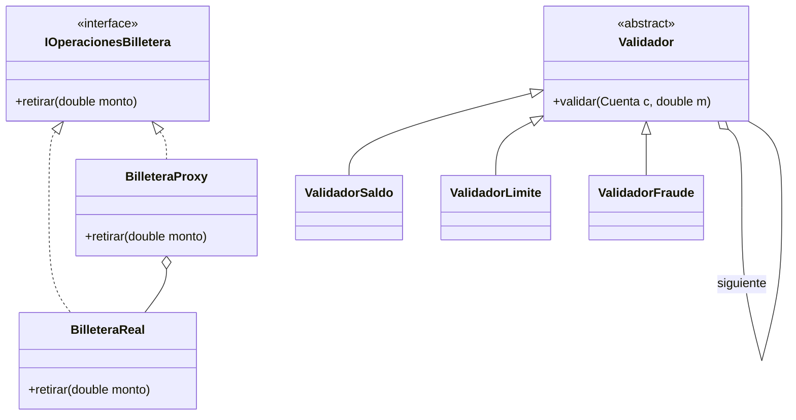

# Billetera Digital - Proyecto POO

## Integrantes
- Matias garzon sanchez
- braulio narvaez
- harold 
- Gabriel
- jeronimo Sepúlveda

## Diagrama de Clases (UML) y Patrones
En este proyecto aplicamos **Proxy** (para controlar el acceso mediante autenticación y loggear operaciones) y **Chain of Responsibility** (para validar el saldo, el límite y prevenir fraudes antes de una transferencia/retiro).

## Trazabilidad de Requisitos
| Tema Evaluado | Archivos Clave donde se aplica |
| --- | --- |
| 1. Pilares POO | `Cuenta.java`, `CuentaPremium.java`, `Main.java` |
| 2. Errores y Excepciones | `BilleteraException.java` y jerarquía, `Main.java` (try/catch/finally) |
| 3. Ordenamiento | `Movimiento.java` (Comparable), `Ordenador.java` (Manual), `Main.java` (Comparator lambda y compuesto) |
| 4. Genéricos | `Repositorio.java`, `Caja.java`, `Utilidades.java` |
| 5. Wildcards | `WildcardUtil.java` |
| 6. Patrones | Paquetes `proxy` y `chain` |
| 7. Funcional y Streams | `Main.java` (average, sum), `ReporteService.java`, `OperacionPersonalizada.java` |
| 8. Logs | `Main.java`, `CuentaProxy.java`, `ValidadorFraude.java` |
